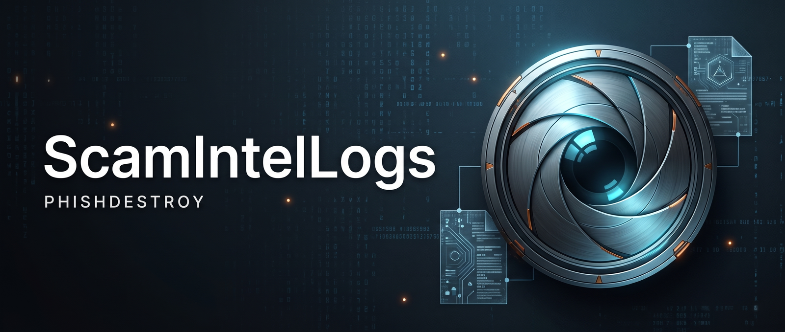

# ScamIntelLogs

**Crypto scam evidence, preserved for investigation.**

ScamIntelLogs is an open-source intelligence archive from PhishDestroy. Explore Telegram chat logs, phishing infrastructure, admin panel artifacts, transaction records and indicators of compromise from documented crypto scam operations.

[**Browse the archive →**](https://phishdestroy.github.io/ScamIntelLogs/) · [Investigation wiki](https://phishdestroy.github.io/ScamIntelLogs/wiki.html) · [Submit evidence](https://t.me/PhishDestroy_bot)

<p align="center">
  
</p>

## Start here

| Your task | Where to go |
|---|---|
| Explore an operation and its evidence | [Archive browser](https://phishdestroy.github.io/ScamIntelLogs/) — select a collection, then an evidence folder. |
| Learn an investigation workflow | [Investigation wiki](https://phishdestroy.github.io/ScamIntelLogs/wiki.html) — OSINT resources, Telegram exports and blockchain tracing. |
| Research traffic cloaking infrastructure | [Keitaro TDS checker](https://phishdestroy.github.io/ScamIntelLogs/keitaro/checker.html). |
| Find a domain blocklist | [destroylist](https://github.com/phishdestroy/destroylist) — the separate domain dataset. |

## Explore the collections

Each collection keeps the context of an operation alongside its available artifacts. Contents vary: some include chats and payment records; others focus on panels, domains or machine-readable indicators.

- [717Team](717Team/)
- [BitXLucky](BitXLucky/)
- [LuxardGambling](LuxardGambling/)
- [MercuryTeam](MercuryTeam/)
- [RublevkaTeam](RublevkaTeam/)
- [TRXDrop](TRXDrop/)
- [TheProject Casino](TheProject%20Casino/)
- [TheProject](TheProject/)
- [TrustWalletPanel](TrustWalletPanel/)
- [WasabiSquad](WasabiSquad/)
- [gambler](gambler/)
- [keitaro](keitaro/)
- [nicecrypto](nicecrypto/)
- [olympus-panel](olympus-panel/)

## Use the evidence

1. **Start with context.** Read the collection description and note the operation, dates and source of the material.
2. **Follow the artifact.** Open the relevant chat export, screenshot, domain list or transaction record. Keep the original file with your research notes.
3. **Record a reproducible reference.** Save the repository path and commit link. For a blockchain transaction, include the network, transaction hash and a block explorer link.
4. **Connect the sources.** Compare the artifact with archived pages, public scans or on-chain records when those sources are available.

For a GitHub file, press **Y** to turn its URL into a permalink to that exact revision. This makes references useful even when the archive changes.

<details>
<summary><strong>Evidence types and directory guide</strong></summary>

### What's Inside

| Data Type | Description |
|-----------|-------------|
| 💬 **Internal Chats** | Telegram group conversations, private messages, operational discussions |
| 🎛️ **Admin Panels** | Screenshots, configs, and audits of scam infrastructure |
| 👥 **Scammer Identities** | Telegram IDs, usernames, wallet addresses, known aliases |
| 💰 **Theft Records** | Victim wallets, stolen amounts, transaction hashes |
| 🎨 **Phishing Assets** | Design templates, clone sites, drainer configs |
| 📊 **Financial Flows** | Payment records, affiliate payouts, laundering paths |
| 🌐 **Infrastructure** | Domains, hosting providers, bot tokens, API endpoints |

Each scam operation gets its own directory. Inside, evidence is organized by type:

```
TeamName/
├── chat/              # Internal Telegram group conversations
├── channel/           # Public channel announcements
├── successful_thefts/ # Confirmed theft records (wallets, tx hashes, amounts)
├── designs/           # Phishing page templates and clone assets
├── payments/          # Payment logs, affiliate payouts
├── scammers_login.txt # Known participant Telegram IDs and usernames
├── domains.txt        # Associated phishing domains
├── iocs.json          # Machine-readable indicators of compromise
└── index.html         # Visual evidence browser for this team
```

Not every team has all folders — it depends on what evidence was collected. The root `index.html` lists all archived operations with descriptions and direct links to every subfolder.

**[Browse the full archive](https://phishdestroy.github.io/ScamIntelLogs/)**

</details>

<details>
<summary><strong>Collection methodology</strong></summary>

> **We do NOT hack, attack, bruteforce, or compromise any systems.**

All data is collected through **passive intelligence gathering**:

- 🔍 **OSINT** — Open-source intelligence from public sources
- 📥 **Leaked Data** — Community-submitted dumps from insiders
- 🕵️ **Social Engineering Artifacts** — Data exposed by scammers themselves
- 📡 **Passive Monitoring** — Public channels, forums, blockchain analysis
- 🎁 **Voluntary Submissions** — Victims and researchers sharing evidence

When admin panel access is obtained (through leaks or misconfiguration), we conduct **non-destructive audits** to document infrastructure without modification.

</details>

## Contribute evidence

Open a pull request from your fork, or contact [@PhishDestroy_bot](https://t.me/PhishDestroy_bot). Use an existing collection where appropriate; otherwise, propose a clearly named directory for the operation.

Include:

- **Context:** operation name, relevant dates and a short description of what the material shows.
- **Sources:** original URLs, archive links or other references that support the submission.
- **Artifacts:** readable exports, screenshots, infrastructure records or transaction evidence.
- **Handling notes:** any redactions, missing context or limits on attribution.

Redact personal victim data before submitting public files. See [SECURITY.md](SECURITY.md) for the project's security reporting process.

<details>
<summary><strong>Purpose, use conditions and license</strong></summary>

### Who Benefits

| Audience | Use Case |
|----------|----------|
| 🔬 **Security Researchers** | Study scam TTPs, drainer mechanics, social engineering |
| 👮 **Law Enforcement** | Evidence for investigations and prosecutions |
| 📰 **Journalists** | Exposés on organized crypto fraud |
| ⚖️ **Victims** | Identify attackers, support recovery efforts |
| 🛡️ **Threat Intel Teams** | IOCs, infrastructure patterns, actor tracking |

### Why Archive This

Scammers systematically destroy evidence — deleting Telegram chats, burning wallets, rotating domains. This archive ensures:

- **Permanent Record** — Evidence survives deletion attempts
- **Pattern Analysis** — Cross-reference actors across operations  
- **Accountability** — Public exposure deters future activity
- **Community Defense** — Shared knowledge protects potential victims

### Use conditions

- This repository contains **evidence of criminal activity** for research purposes
- Data is provided **"as-is"** without verification guarantees
- **Do not use** this data for harassment, vigilante justice, or illegal purposes
- **Victim PII** should be handled responsibly
- We are **not responsible** for misuse of this information

### License

The [LICENSE](LICENSE) contains the MIT software license and additional terms for intelligence data, including research, journalism, anti-fraud work and law enforcement use. Refer to that file for the full terms.

</details>

## More from PhishDestroy

- [DestroyScammers](https://github.com/phishdestroy/DestroyScammers) — explore domain intelligence and infrastructure relationships.
- [destroylist](https://github.com/phishdestroy/destroylist) — phishing and scam domain data.
- [phishdestroy.io](https://www.phishdestroy.io/) · [Updates on X](https://x.com/Phish_Destroy).

**Scammers delete evidence. We preserve it.**
